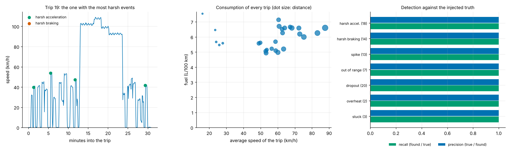

# vtel: trips, fuel, harsh driving and sensor faults from an OBD-II log, checked two ways

[](https://github.com/TexAlphaWolf/ana-vehicle-telemetry/actions/workflows/ci.yml)
[](https://github.com/TexAlphaWolf/ana-vehicle-telemetry/actions/workflows/codeql.yml)


A telemetry analyser for drive logs from an OBD-II adapter (one CSV row per sample: speed, rpm, throttle, engine load, coolant
temperature, fuel flow). It cleans the signal (impossible values, one-sample spikes, short holes), splits the log into trips,
and reports the distance, duration, standing time and **fuel consumption of every trip**, the **harsh accelerations and
braking**, and the **sensor faults**: overheating, stuck sensors, holes. The analysis is vectorised, and a second
implementation that **walks the log one sample at a time in plain Python** checks it. Real logs come with no answer key, so the
project also ships a **synthetic vehicle that knows the truth**: the true distance and fuel of every trip, every harsh ramp and
every injected fault. A command line (`vtel`) with tests, a Docker image and reports generated from the numbers.



## What the numbers say

The demo log ([`docs/report.json`](docs/report.json)) is 14 days of synthetic driving: 52,542 samples, 27 trips, with faults
injected at known times. **The vehicle is synthetic and illustrative**, not a measurement of a real car; the point is what the analysis
does with a log whose answers are known. Speed figures are from one run in Docker on Linux x86_64 with 12 CPUs, Python 3.14.10 and
NumPy 2.5.4 ([`docs/bench.json`](docs/bench.json); medians of 5 runs).

1. **The log holds 27 trips, 806.9 km in 13.2 hours of driving, at 5.99 L/100 km.** Vehicles stand still for 15.9% of the
   driving time (traffic lights, queues). Per trip, consumption goes from 4.94 to 7.54 L/100 km.
2. **Consumption is not monotonic in speed.** Grouped by the average speed of the trip it is 6.26 L/100 km under 25 km/h, 5.28 at
   40 to 60 km/h and 6.45 at 80 to 100 km/h: idling in town and drag on the motorway both cost fuel.
3. **32 harsh events in 806.9 km**: 18 harsh accelerations (2.23 per 100 km) and 14 harsh brakings (1.74 per 100 km).
   Removing the 13 speed spikes does not change these counts (a one-sample jump is shorter than the minimum event) but it does
   change the maximum speed: without it, 6 trips would report up to 212.5 km/h instead of 131.5.
4. **Sensor faults are found**: 2 overheatings (75 s and 76 s above 110 C), 3 stuck sensors, 13 speed spikes, 7 values outside the
   physical range, and 20 holes in the speed signal (15 interpolated, 5 too long to repair and left as holes).
5. **Against the truth, on the demo log**: all 27 trips are found; the total distance is off by -0.06%, the consumption of a
   trip by 0.27% (median) and 1.59% (worst); the 77 injected events and faults are all found, with no false alarm.
6. **Across 20 synthetic logs (564 trips, 18,810 km)**: all 564 trips matched; per trip, the distance is off by 0.03% (median)
   and 1.10% (95th percentile), the consumption by 0.17% and 1.35%. 305 of 308 harsh accelerations and 208 of 210 harsh
   brakings are found, with no false alarm; **the 5 that are missed fell inside a hole of the data**, where nothing can be seen.
7. **Two implementations, one answer.** The NumPy analysis and the plain Python one agree to 2.08e-16 (relative) on 51
   comparisons and 15,960 numbers, on generated logs and on logs spoiled on purpose with random thresholds.
8. **Speed.** 3,000,000 samples (833 hours of driving) are analysed in 0.97 s, 3.10 million samples a second; the plain Python
   implementation does 264,366 a second, so the NumPy one is 12 to 15 times faster.

[`docs/analysis.md`](docs/analysis.md) goes through the results and what the truth taught; [`docs/report.md`](docs/report.md) and
[`docs/bench.md`](docs/bench.md) are the generated reports; [`docs/method.md`](docs/method.md) defines every step.

## Quick start

With Docker (nothing else to install):

```bash
docker build -t vtel .
docker volume create vtelv
docker run --rm --user 0 -v vtelv:/data --entrypoint chown vtel 10001 /data
RUN="docker run --rm --read-only --tmpfs /tmp --cap-drop ALL --security-opt no-new-privileges --network none -v vtelv:/data vtel"
$RUN generate -o /data/drive.csv --truth /data/truth.json    # a synthetic log and its truth
$RUN analyze /data/drive.csv --truth /data/truth.json --out /data/out   # report.json, report.md, summary.png
```

With Python 3.11 to 3.14:

```bash
pip install .
vtel analyze drive.csv --out out                # your own log
vtel analyze                                    # the demo log, with its truth
vtel verify                                     # NumPy analysis against the plain Python one
```

## Real output

`vtel analyze` (the demo log):

```text
demo drive log (synthetic, 14 days, seed 1): 52,542 samples, 27 trips, 806.9 km in 13.2 h, 5.99 L/100 km
harsh acceleration 18 (2.23 per 100 km), harsh braking 14 (1.74 per 100 km)
faults: 2 overheating, 3 stuck sensor; 13 spikes, 7 out-of-range samples, 20 holes in the speed signal
against the truth: 27 of 27 trips matched, distance error -0.06% in total, consumption error 0.27% (median per trip)
events and faults: 77 of 77 found, 0 false alarms
```

## The log file

CSV, one row per sample, with a header (case-insensitive; a few aliases such as `speed` or `engine_rpm` are accepted):

| Column | Unit | Notes |
|---|---|---|
| `time` | ISO 8601 or seconds since the epoch | required; must increase from row to row; irregular sampling is fine |
| `speed_kmh` | km/h | required |
| `rpm`, `throttle_pct`, `load_pct`, `coolant_c` | rpm, %, %, degrees C | optional |
| `fuel_lph` | L/h | optional; a mass air flow column `maf_gs` (g/s) is converted with `--afr` and `--density` |

An empty cell, `nan`, `na` or `null` is a missing sample. A problem is an error that names the line (`line 4210: cannot read
'abc' as a number in column rpm`).

## Commands

| Command | What it does |
|---|---|
| `vtel generate -o FILE [--truth FILE] [--days N] [--seed S] [--clean]` | Writes a synthetic drive log (and its truth) |
| `vtel validate FILE` | Reads a log and says what is in it |
| `vtel analyze [FILE] [--truth FILE] [--out DIR] [thresholds]` | Trips, consumption, harsh driving, faults; scored when the truth is given; writes `report.json`, `report.md`, `summary.png` |
| `vtel verify [--draws N] [--seed S]` | Compares with the plain Python implementation on random logs; exit 1 on a difference |
| `vtel bench [--sizes A,B,C] [--repeat R] [--draws N] [--seeds N] [--out DIR]` | Speed, accuracy against the truth, agreement of the two implementations |
| `vtel render FILE.json [-o FILE.md] [--figure FILE.png]` | Rebuilds the Markdown (and figure) from a `report.json` or `bench.json` |

The thresholds (`--accel-ms2`, `--brake-ms2`, `--park-s`, `--gap-s`, `--max-fill-s`, ...) are listed by `vtel analyze --help`
and defined in [`docs/method.md`](docs/method.md). Without a FILE, `analyze` uses the demo log. Exit codes: 0 success, 1 a
verification mismatch, 2 an error (unreadable log, bad options).

## How it is checked

- [`reference.py`](src/vehicletelemetry/reference.py) is the same analysis with no arrays: loops over samples and intervals.
  `vtel verify` compares it with the NumPy one on a generated log and on random logs that are made hostile (irregular
  sampling, holes, impossible values, stuck channels, long silences) with random thresholds. The tests do it on every hand-built case too, and
  show the check can fail.
- The **synthetic truth** ([`generate.py`](src/vehicletelemetry/generate.py)) is a vehicle with a speed profile, gears, a power
  model and a warm-up curve, a sensor with noise and quantisation, and faults injected at known times. `vtel analyze --truth`
  scores the analysis against it: trips matched, error of distance and consumption, and precision and recall of every detector.
  Scoring found three bugs while this project was built (see [`docs/analysis.md`](docs/analysis.md)).

## Development

```bash
pip install -e ".[dev]"
ruff check . && ruff format --check . && mypy && pytest --cov
```

CI runs this on Python 3.11 to 3.14, again with more random logs and another seed, on Windows and macOS, builds the Docker image
and runs the end-to-end scripts (`tools/docker_e2e.sh`, and `tools/docker_e2e.ps1` from PowerShell). `tools/run_full.ps1`
produces the measurements in this README.

## Limits

The vehicle and its faults are synthetic, so detection is shown on faults as clean as the generator makes them; the thresholds
are those of a petrol hatchback and need tuning for another vehicle; a hole in the data hides whatever happened in it; fuel
comes from the log, not from the tank. See [`docs/limitations.md`](docs/limitations.md).

MIT license.
